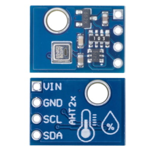
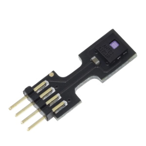
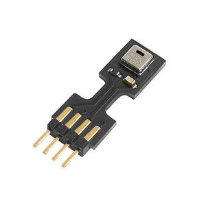
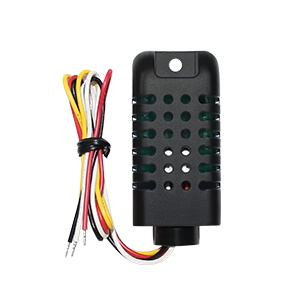

# AHT2x/AM2301B temperature and humidity sensor

??? failure "This feature is not included in precompiled binaries"  

    When [compiling your build](Compile-your-build) add the following to `user_config_override.h`:
    ```arduino
    #ifndef USE_AHT2x
    #define USE_AHT2x       // [I2cDriver43] Enable AHT20/AM2301B instead of AHT1x humidity and temperature sensor (I2C address 0x38) (+0k8 code)
    #endif
    ```

## Configuration

### Wiring
| AHT   | ESP |
|---|---|
|VCC   |3.3V
|GND   |GND   
|SDA   | GPIOx
|SCL   | GPIOy


### Tasmota Settings 
In the **_Configuration -> Configure Module_** page assign:

1. GPIOx to `I2C SDA`
2. GPIOy to `I2C SCL`

After a reboot the driver should detect the sensor and display sensor readings.

### Troubleshooting
On some I2C sensors, like the AHT25, Tasmota might mistake the sensor for another one using the same address.
This can be resolved by disabling the unneeded drivers.

For our example AHT25, the address might get confused with the VEML6070 UV sensor. You can tell Tasmota to use the other driver by issuing the following commands in the console:

- `I2CDriver12 0` to disable the VEML driver
- `I2CDriver43 1` to enable the AHT driver

An overview of all [I2C drivers](https://tasmota.github.io/docs/I2CDEVICES/#supported-i2c-devices) is available in the docs.

### Deep sleep
The AHT20 stays powered while the ESP is in `DeepSleep` and is initialized again on every wake. The driver soft-resets the sensor, checks that the measurement started and verifies the CRC of the 7-byte reading. If a reading fails, the previous values are kept and the measurement is retried a second later, up to 3 times, before the normal 11 second cycle resumes.

### Diagnostics
When [compiling your build](Compile-your-build) add the following to `user_config_override.h`:
```arduino
#define USE_AHT_DIAG    // Add AHT20/AHT30 diagnostics (AHT2XDiag) to the sensor JSON
```
The sensor JSON then contains:
```json
"AHT2XDiag":{"Init":"1C","Trig":"9C","Read":"1C","NoAck":0,"Crc":0,"ReadErr":0,"Reset":0}
```

| Field | Meaning |
|---|---|
|`Init` | Sensor status after init (hex). `18` or `1C` is calibrated and idle
|`Trig` | Status right after the measurement trigger. Bit `0x80` set means the measurement started
|`Read` | Status byte of the last reading
|`NoAck` | Triggers the sensor did not start
|`Crc` | Readings rejected because of a CRC error
|`ReadErr` | Short, still busy or all-zero readings
|`Reset` | Sensor resets after a failed trigger

The counters start at zero on every boot, so with `DeepSleep` they only cover the current wake.

### Breakout Boards



[AHT20 Datasheet](http://www.aosong.com/userfiles/files/media/Data%20Sheet%20AHT20.pdf)    
[AHT21 Datasheet](http://www.aosong.com/userfiles/files/media/Data%20Sheet%20AHT21.pdf)
[AHT25 Datasheet](http://www.aosong.com/userfiles/files/media/Data%20Sheet%20AHT25%20A2.pdf)
